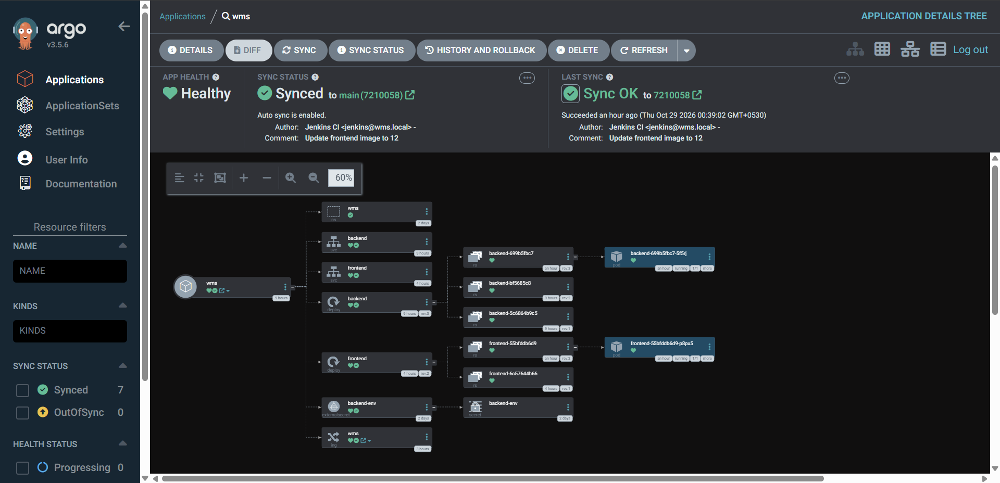

# Water Management System: GitOps Repository

Kubernetes manifests for the Water Management System. **ArgoCD watches the `k8s/` directory** and keeps the EKS cluster in sync with whatever is on `main`. Nothing here is applied by hand.

The cluster and its tooling are created by the [infra repo](https://github.com/KaveenAlahapperuma/water-management-system-infra).

## How a change reaches the cluster

1. A push to the backend or frontend repo triggers a Jenkins build through a GitHub webhook.
2. Jenkins builds and scans the image, pushes it to ECR and tags it with the build number.
3. Jenkins commits the new tag to the matching `*-deployment.yaml` in this repo. These are the "Update ... image to N" commits by Jenkins CI.
4. A GitHub webhook tells ArgoCD, which syncs the change and does a rolling update.

To roll back, revert the commit. ArgoCD restores the previous version.

## Contents (`k8s/`)

| File | Purpose |
|---|---|
| `backend-deployment.yaml` | Spring Boot backend (port 8081, `prod` profile, env from the `backend-env` secret) |
| `backend-service.yaml` | ClusterIP service |
| `frontend-deployment.yaml` | nginx serving the built React app |
| `frontend-service.yaml` | ClusterIP service |
| `externalsecret.yaml` | Pulls `wms/backend` and the RDS-managed database login from AWS Secrets Manager into the `backend-env` secret |
| `ingress.yaml` | ALB ingress: `/api` and `/ws` go to the backend, everything else to the frontend |

## Notes

- ArgoCD runs with automated sync, `prune` and `selfHeal`. Anything deleted from this directory is deleted from the cluster, so an incomplete manifest can remove a live resource (I learned this the hard way with the Ingress).
- No secrets are stored here. Credentials come from AWS Secrets Manager through the External Secrets Operator.
